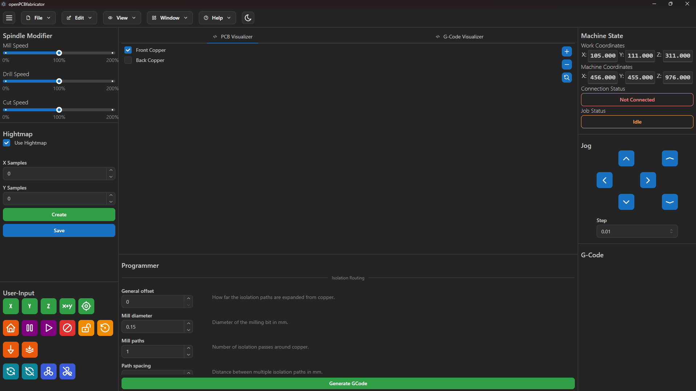
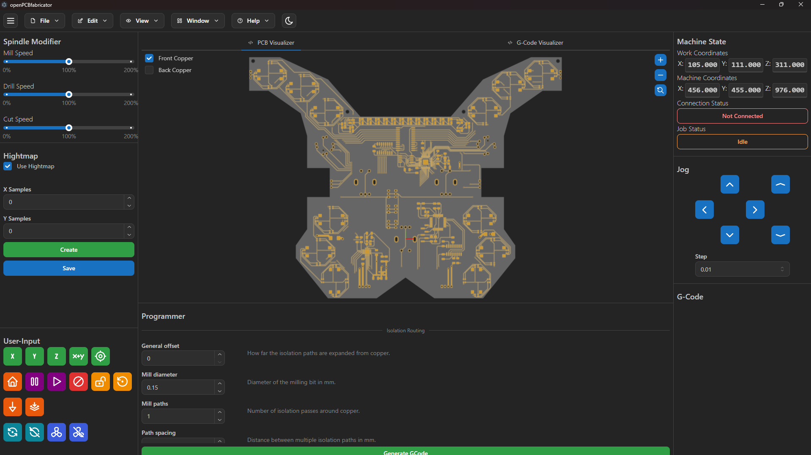
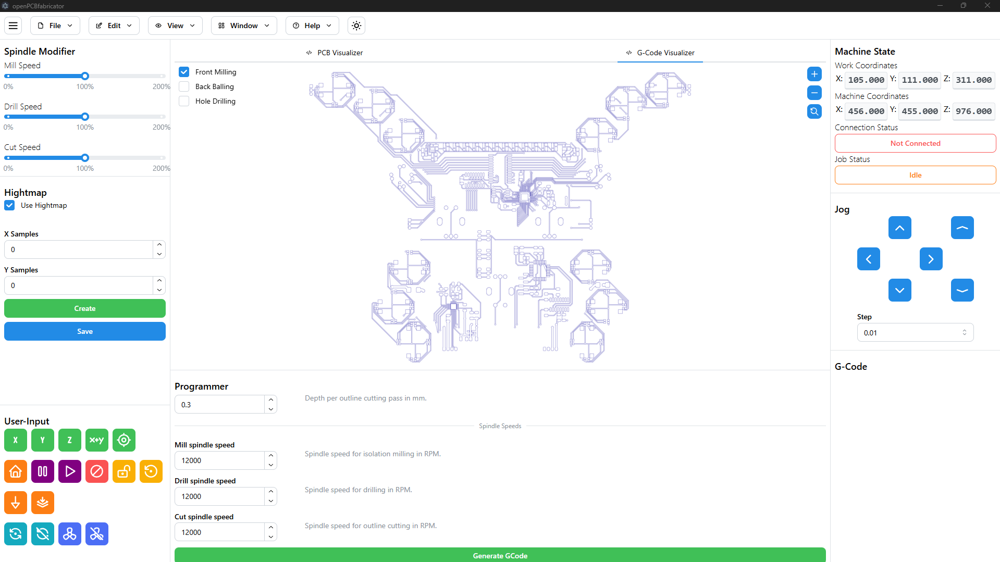

# openPCBfabricator

Electron-based application for converting KiCad PCB fabrication files into CNC G-code for isolation milling, drilling, and board outline cutting.

Status: **Under development**

## Features

### PCB Import and Processing

- Import PCB fabrication files from ZIP archives exported by KiCad
- Automatic extraction and processing of the archive
- Processing of front and back copper layers
- Processing of drill holes and board outlines
- Internal representation of PCB geometry for visualization and toolpath generation

### PCB Visualization

- Visualization of front and back copper layers
- Individual layer visibility
- Zoom and viewport controls

### G-Code Generation

G-code generation for the following machining operations:

| Operation | Description |
|-----------|-------------|
| Front Isolation Milling | Isolation routing of front copper traces |
| Back Isolation Milling | Isolation routing of back copper traces |
| Hole Drilling | Drilling of PCB holes |
| Board Outline Cutting | Cutting of the PCB outline |

Generated G-code files can be exported individually.

### Isolation Routing

| Parameter | Default | Unit | Description |
|-----------|---------|------|-------------|
| General Offset | 0 | mm | Additional offset applied to isolation paths around copper |
| Mill Diameter | 0.15 | mm | Diameter of the isolation milling tool |
| Mill Paths | 1 | - | Number of isolation passes around copper |
| Path Spacing | 0.15 | mm | Distance between consecutive isolation paths |

### Heights

| Parameter | Default | Unit | Description |
|-----------|---------|------|-------------|
| Safe Height | 3 | mm | Z height used for travel movements |
| Mill Depth | -0.05 | mm | Z depth for isolation milling |
| Cut Depth | -1.8 | mm | Final Z depth for board outline cutting |
| Drill Depth | -1.8 | mm | Z depth for drilling holes |

### Feedrates

| Parameter | Default | Unit | Description |
|-----------|---------|------|-------------|
| Mill Feedrate | 250 | mm/min | Feedrate for isolation milling |
| Drill Feedrate | 100 | mm/min | Feedrate for drilling operations |
| Cut Feedrate | 200 | mm/min | Feedrate for board outline cutting |
| Cut Infeed | 0.3 | mm | Maximum depth per outline cutting pass |

### Spindle Speeds

| Parameter | Default | Unit | Description |
|-----------|---------|------|-------------|
| Mill Spindle Speed | 12000 | RPM | Spindle speed for isolation milling |
| Drill Spindle Speed | 12000 | RPM | Spindle speed for drilling |
| Cut Spindle Speed | 12000 | RPM | Spindle speed for board outline cutting |

### G-Code Visualization

- Visualization of generated toolpaths
- Separate display of front milling, back milling, and drilling operations
- Display of board outline toolpaths
- Individual visibility controls
- Zoom and viewport controls

### User Interface

- Dark and light themes
- Separate PCB and G-code visualization views
- Routing parameter configuration
- Spindle speed modifier controls
- Heightmap configuration interface
- CNC machine control interface (not yet functional)

---

## Workflow

### 1. Export from KiCad

Export the required PCB fabrication files from KiCad.

### 2. Import PCB

Load the ZIP archive into openPCBfabricator.

The application extracts the archive, processes the fabrication data, and displays the PCB geometry.

### 3. Configure Toolpaths

Configure the isolation routing parameters:

### 4. Generate G-Code

Generate G-code for the supported machining operations.

The resulting toolpaths can be inspected in the G-code visualizer.

### 5. Export

Direct G-code streaming to CNC controllers is not currently implemented.

---

## Heightmap Compensation

**Status: Planned / UI implemented**

The heightmap interface contains the following parameters:

| Parameter | Description |
|-----------|-------------|
| Use Heightmap | Enable or disable heightmap compensation |
| X Samples | Number of probe samples along the X-axis |
| Y Samples | Number of probe samples along the Y-axis |

Planned functionality:

- Probe the PCB surface at multiple X/Y coordinates
- Generate a surface heightmap
- Interpolate Z offsets between measured points
- Apply Z-axis compensation to generated milling toolpaths

---

## CNC Machine Control

**Status: Planned / UI implemented**

The application includes an interface for future CNC machine communication.

### Machine State

- Work coordinates (X, Y, Z)
- Machine coordinates (X, Y, Z)
- Connection status
- Job status

### Machine Controls

- X/Y/Z jogging
- Configurable jog step
- Homing
- Job start, pause, and stop
- Coordinate and machine control functions

### Planned Communication

- Serial / USB communication
- GRBL protocol support
- Real-time machine status updates
- G-code streaming
- Machine position monitoring
- Job execution and progress tracking

Machine communication and execution controls are not yet implemented.

---

## Technology

| Component | Technology |
|-----------|------------|
| Desktop Application | Electron |
| Programming Language | JavaScript |
| PCB Input | KiCad fabrication ZIP archive |
| CNC Output | G-code |

---

## Development Status

| Feature | Status |
|---------|--------|
| KiCad ZIP Import | Implemented |
| Automatic File Extraction | Implemented |
| PCB Visualization | Implemented |
| Front / Back Copper Processing | Implemented |
| Isolation Routing | Implemented |
| Drill G-Code Generation | Implemented |
| Board Outline G-Code | Implemented |
| G-Code Visualization | Implemented |
| G-Code Export | Implemented |
| Routing Parameter Configuration | Implemented |
| Dark / Light Mode | Implemented |
| Heightmap Compensation | Planned |
| CNC Serial Connection | Planned |
| GRBL Integration | Planned |
| Manual Machine Jogging | Planned |
| G-Code Streaming | Planned |
| Machine Status Monitoring | Planned |

---

